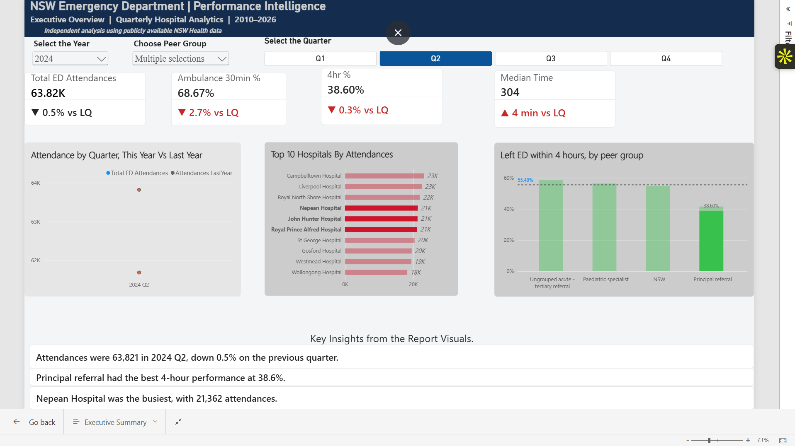

# NSW Emergency Department | Performance Intelligence

Interactive Power BI dashboard analysing quarterly emergency department performance across NSW hospitals from 2010 to 2026.
** Key Snapshots from the Report **
(2012.png)

▶ **[Watch the 60-second demo](https://youtu.be/_wXEwh_a2VA)**

## The question

How is emergency department demand changing, and how are hospitals performing on patient waiting times and ambulance transfers?

## What the dashboard shows

- **KPI cards:** Total ED attendances, percentage leaving within 4 hours, median time to leave, and ambulance transfers within 30 minutes, with changes compared to the previous quarter.
- **Attendance trends:** Quarterly ED attendances compared with the previous year.
- **Peer-group performance:** Comparison of 4-hour ED performance across hospital peer groups.
- **Top 10 hospitals:** Busiest hospitals ranked by ED attendances.
- **Dynamic insights:** Automatically generated summaries that update with the selected filters.
- **Interactive slicers:** Explore performance by year, quarter, and hospital peer group.

## How it's built

- **Python:** Cleaned and prepared the raw NSW Health data using Pandas.
- **SQL:** Loaded the cleaned data into MySQL to explore and validate hospital records, attendance volumes, and reporting periods.
- **Data model:** Star schema with Calendar, Dim Entity, and Dim Measure dimensions connected to a long-format fact table (`measure_name` / `measure_value`).
- **DAX:** Explicit KPI measures, time intelligence (`DATEADD`, `SAMEPERIODLASTYEAR`), quarter-over-quarter comparisons, conditional formatting, and dynamic text measures.
- **Design:** One-page executive overview with interactive slicers, a consistent colour palette, and red and green indicators for performance changes.

## Key findings (2024)

- **Significant differences in ED performance:** District Group 2 had the highest 4-hour performance at 79.2%, compared with 42.5% for Principal Referral hospitals, a difference of 36.7 percentage points.

- **High emergency department demand:** NSW recorded approximately 2.94 million ED attendances in 2024. Campbelltown Hospital was the busiest, with 92,096 attendances, while statewide 4-hour performance was 60.63%.

## Data

**Source:** [NSW Bureau of Health Information, Downloadable Data](https://www.bhi.nsw.gov.au/downloadable-data)

Publicly available NSW emergency department performance data from the Bureau of Health Information.

This is an independent portfolio project and is not affiliated with or endorsed by NSW Health.

## Files

- `Page1.png`: Dashboard preview
- `.pbix`: Full interactive Power BI report (open in Power BI Desktop)
- `NSW_ED_Dashboard.pdf`: Static dashboard export

## Tools & Technologies

**Python | Pandas | MySQL | SQLAlchemy | Power BI | Power Query | DAX**
